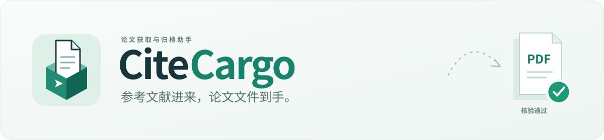

### 把找论文的时间，还给研究。

**粘贴参考文献，获取论文全文；需要时，再归档到 Zotero。**

[下载操作页版](https://github.com/Xplore-LAB/paper-tool/releases/download/v2.0.0/CiteCargo-2.0.0-Windows.zip) · [下载 AI 技能](https://github.com/Xplore-LAB/paper-tool/releases/download/v2.0.0/CiteCargo-2.0.0-Skill.zip) · [英文版](docs/README.en.md) · [反馈](https://github.com/Xplore-LAB/paper-tool/issues)

> **2.0.0 已更新**：离线技能包内置下载引擎，支持任务计划、安全调度与结构化报告。[查看使用方法](docs/usage.md#v2-任务接口)。

给它一个 DOI、一条完整参考文献，或一份论文清单。它会查找可获取的正文、核验 PDF、保留下载进度。**只要文件就下载到本地，想建文献库再选择 Zotero 归档。**

## 选你顺手的方式

| 使用方式 | 你需要做什么 | 适合谁 |
|---|---|---|
| **AI 技能** | 安装后，把论文需求直接告诉 AI | 已使用能执行本机命令的 AI 助手 |
| **本地操作页** | 双击启动，粘贴清单，点击“开始下载” | 希望自己点击操作的科研人员 |

技能与操作页共用同一下载引擎，默认都不连接 Zotero。

## 三步开始

**交给 AI：** 下载技能包，解压后把 `citecargo` 文件夹放进助手支持的技能目录。在 Codex 中放入 `~/.codex/skills/`，重开会话即可使用：

> 用文献直达帮我下载这些论文，只要正文，保存到我的课题文件夹。

助手会处理安装与运行。需要 Python 3.10+，以及支持本地命令执行的 AI 客户端。[技能安装说明](docs/agents.md)

**自己操作：** Windows 下载操作页压缩包，解压整个文件夹，双击 `Start-CiteCargo.cmd`。浏览器打开后：

1. 粘贴 DOI 或完整参考文献，每行一篇。
2. 点击“开始下载”，查看逐篇结果。
3. 打开保存文件夹，或把 PDF 打包取回。

首次需要安装 Python 3.10+；压缩包已包含基础依赖。本版是本地浏览器操作页，启动窗口需保持打开。[安装与使用手册](docs/usage.md#本地操作页) 包含其他系统的启动方法。

## 少找、少下、少整理

- **参考文献直接用**：自动匹配 DOI，查询开放全文，支持整份清单。
- **下载之后先核验**：检查文件可读性及论文身份，待复核条目单独标出。
- **失败项接着补**：保留已核验 PDF，按论文续跑，不必整批重下。
- **文件与文献库随你选**：独立下载无需 Zotero；归档时使用已有分类、按 DOI 去重并附加 PDF。
- **衔接学校订阅**：可选 ScienceDirect 授权浏览器路径，支持已有校园网、VPN 或代理环境。

学校订阅需要你已有的访问权限与额外浏览器组件，目前自动回退覆盖带 Crossref 出版商标识的 ScienceDirect 论文。Zotero 归档需 Zotero 10+ 开启本地接口并授权。

## 一次真实交付

结果卡来自已完成的真实下载报告。示例论文：[10.1371/journal.pone.0000308](https://doi.org/10.1371/journal.pone.0000308)。

[进阶用法与机构访问](docs/usage.md) · [表格清单导出](docs/reports.md) · [参与开发](.github/CONTRIBUTING.md) · [更新记录](docs/changelog.md)

本地测试与浏览器操作流程已验证。Windows 启动脚本、跨平台自动检查及真实 Zotero 验收的验证范围见[发布说明](https://github.com/Xplore-LAB/paper-tool/releases/latest)。
