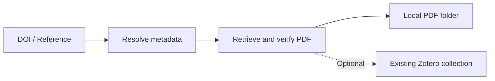

<div align="center">

# paper-tool

### Academic Paper Downloader · DOI to PDF · Optional Zotero Import

**从 DOI 或参考文献，到已核验的论文 PDF；需要时，再归档到 Zotero。**

[](https://github.com/Xplore-LAB/paper-tool/releases/latest)
[](https://github.com/Xplore-LAB/paper-tool#快速开始)
[](LICENSE)

[快速开始](#快速开始) · [下载发行版](https://github.com/Xplore-LAB/paper-tool/releases/latest) · [English](docs/README.en.md) · [使用手册](docs/SOP.md) · [反馈问题](https://github.com/Xplore-LAB/paper-tool/issues)

</div>

**paper-tool 是一个 Python 命令行论文下载工具**：支持 DOI 转 PDF、完整参考文献匹配 DOI、开放获取全文检索、批量下载与断点续跑，以及可选的 Zotero 文献归档。只下载 PDF 时，无需安装或启动 Zotero。

*A Python CLI academic paper downloader for DOI-to-PDF retrieval, citation resolution, resumable batch downloads, and optional Zotero import.*

| 下载几篇论文 | 批量整理参考文献 | 扩充 Zotero 文献库 |
|---|---|---|
| 输入 DOI 或完整引用，保存已核验 PDF | 每行一篇，记录进度，中断后续跑 | 复用下载结果，按 DOI 去重，归入已有分类 |
| `fetch` | `batch` | `batch --zotero --collection` |

## 为什么使用 paper-tool

- **参考文献直接变成下载任务**：已有 DOI 就精确解析；没有 DOI 时，用完整引用通过 Crossref 匹配题录。不确定的匹配留待核对。
- **找到 PDF，还要确认是哪篇论文**：检查 PDF 格式、可读性与首页题名；DOI、作者用于相应核验路径，避免把登录网页或引用了目标 DOI 的错误论文当成全文。
- **批量任务可以接着跑**：检查点、SHA-256 与本地文件复用共同支持续跑，失败清单可以直接用于下一轮。
- **下载与入库分开完成**：今天只要 PDF，以后可复用同一批次目录扩充 Zotero；归档失败仍保留已核验文件。
- **开放全文与机构访问衔接**：先尝试 OpenAlex / Unpaywall 等开放来源；有授权时，可选 ScienceDirect 浏览器回退，支持已有 VPN 或 HTTP 代理。
- **适合终端、脚本与科研 Agent**：逐篇 JSON、明确退出码、可复核状态；运行时仅需 Python 与 `pypdf`，无需新增后台服务。



PDF 获取顺序：**已核验本地文件 → 开放获取全文 → 已授权的机构浏览器**。默认仅下载正文，保留正文自带附录，不另外获取 Supporting Information。

## 快速开始

需要 **Python 3.10+**。从 [GitHub Releases](https://github.com/Xplore-LAB/paper-tool/releases/latest) 下载 wheel 后安装：

```bash
python -m pip install ./paper_tool-1.0.0-py3-none-any.whl
paper-tool --version

# 下载一篇开放论文，不连接 Zotero
paper-tool fetch "10.1371/journal.pone.0000308" --oa-only --out ./PDF
```

也可以从源码安装：

```bash
git clone https://github.com/Xplore-LAB/paper-tool.git
cd paper-tool
python -m venv .venv
# Linux/macOS: source .venv/bin/activate
# Windows: .venv\Scripts\activate
python -m pip install .
```

源码目录支持 `python paper_tool.py <command>`。本项目当前通过 GitHub 发布，尚未发布到 PyPI。

## 三种常用工作流

### 1. 只下载 PDF：DOI 或完整参考文献

```bash
# DOI → PDF
paper-tool fetch "10.1371/journal.pone.0000308" --out ./PDF

# 先预览完整引用的匹配结果，再下载
paper-tool preview "Piwowar HA, Day RS, Fridsma DB. Sharing Detailed Research Data Is Associated with Increased Citation Rate. PLoS ONE, 2007."

# 每行一篇的小清单；跳过已经完成且核验有效的本地结果
paper-tool fetch --input references.txt --out ./PDF --skip-done
```

没有 DOI 时，请输入包含作者、完整题名、期刊和年份的参考文献。纯题名或歧义匹配可能需要补充信息。

### 2. 批量下载论文：清单输入、进度记录、断点续跑

`references.txt` 示例：

```text
# 一行一篇：DOI 或完整参考文献，UTF-8 编码
10.1371/journal.pone.0000308
Piwowar HA, Day RS, Fridsma DB. Sharing Detailed Research Data Is Associated with Increased Citation Rate. PLoS ONE, 2007.
```

这两行演示同一篇论文的两种输入方式，实际清单按需要保留一种即可。

```bash
paper-tool batch --input references.txt --out my-batch --oa-only

# 中断后运行同一条命令；已核验文件优先复用
paper-tool batch --input references.txt --out my-batch --oa-only

# 查看进度，导出仍缺全文的论文
paper-tool progress --out my-batch
paper-tool failures --out my-batch --write pending.txt
```

续跑按论文记录进度；未完成文件会重新获取。默认单篇串行，论文间隔 30 秒，不限制文件传输速度。请让同一批次目录只由一个进程写入。

### 3. Zotero 自动归档：先下载，以后再入库

```bash
# 读取已有分类；需要 Zotero 开启本地 API
paper-tool collections --json

# 复用 my-batch 中的 PDF 和完整题录，加入指定已有分类
paper-tool batch --input references.txt --out my-batch --zotero --collection "已有分类完整路径"

# 只导入题录，不检索或上传 PDF
paper-tool batch --input references.txt --out my-batch --zotero --collection "已有分类完整路径" --metadata-only

# 检查附件；列出包含归档未完成项的待办
paper-tool audit --out my-batch --json
paper-tool failures --out my-batch --zotero --json
```

需要 **Zotero 10+** 开启本地 API，并在首次写入时授权。默认地址为 `http://127.0.0.1:23119/api`。按 DOI 复用条目、增量加入目标 Collection；不创建分类、不覆盖已有题录、不删除条目。

Zotero 位于另一台电脑时，使用只绑定回环地址的 SSH 转发；连接步骤见下方进阶配置。**真实桌面 Zotero 归档仍需在你的环境验收**，模拟测试不等于已完成真实入库。

## 机构订阅论文：ScienceDirect、校园 VPN 与 zju-connect

有自己的有效访问权限时，可以让工具调用已登录的 Chrome / Edge，通过 ScienceDirect 的 View PDF 流程取得正文。

```bash
# 可选依赖：Node.js 22+，在当前项目/工作目录安装
npm install playwright-core
paper-tool browser --start

# 在该浏览器中完成必要的机构登录，再运行下载
paper-tool fetch "你的 DOI" --out ./PDF

# 已有 zju-connect HTTP 代理时
paper-tool fetch "你的 DOI" --out ./PDF --proxy http://127.0.0.1:1081
```

原生 VPN 已连接时默认使用直连；不依赖 zju-connect 才能运行。浏览器自动回退目前只覆盖 **Crossref 提供 PII 的 ScienceDirect / Elsevier 论文**。其他出版商、验证挑战或授权失效会保留待处理状态。`--oa-only` 完全关闭机构浏览器分支。

工具使用开放来源或用户已有的访问权限，不代做机构登录、不绕过访问控制、不保存学校密码。

## 你会得到什么

```text
my-batch/
├── PDF/             # 核验后的论文正文
└── manifest.json    # 逐篇题录、状态、文件哈希与归档结果
```

`fetch` 使用 `report.json`；`batch` 使用 `manifest.json`。可选 `deliverables.py` 可进一步生成 Excel 文献台账和完成情况汇报，见 [交付物说明](docs/deliverables.md)。

| 状态 | 你可以据此判断什么 |
|---|---|
| `PDF_SAVED` | PDF 已在本地核验；Zotero 结果另看 `zotero` 字段 |
| `PDF_ATTACHED` / `PDF_ALREADY_PRESENT` | 本轮附件上传或实时确认完成 |
| `METADATA_ONLY` | 本轮仅完成题录入库 |
| `PDF_PENDING` | 本轮未取得可核验全文 |
| `NEEDS_REVIEW` | 题录、文件或运行环境需要复核 |

归档时重新确认当前分类和附件，避免切换分类后沿用旧完成记录。上传中断优先向原附件记录补传；无法安全确认的已有附件会保留待复核。

## 常见问题

**Can I download papers without Zotero? / 不用 Zotero 能下载吗？**

可以。`fetch` 和 `batch` 默认只下载，只有显式增加 `--zotero --collection` 才归档。

**Can I download a PDF from a DOI or citation? / 没有 DOI 怎么办？**

支持 DOI 和完整参考文献，Crossref 负责 DOI 与元数据匹配。支持输入格式是文本单条或逐行清单，Word、RIS、BibTeX 文件直接解析尚未实现。

**Can I resume batch PDF downloads? / 批量下载中断怎么办？**

使用原清单和同一 `--out` 目录重跑。哈希未变的已核验文件可以复用；无哈希的旧检查点重新核验身份。独立下载完成与 Zotero 入库完成分开记录。

**Does it support institutional access? / 学校订阅能用吗？**

可选 ScienceDirect 授权浏览器路径，需要你已经具备机构访问权限。扫描件、无法可靠提取文本或身份不确定的 PDF 需要人工复核。

## 进阶配置与接口

<details>
<summary><strong>环境变量、另一台电脑上的 Zotero、1.x CLI 契约</strong></summary>

系统环境变量均可选。`.env.example` 是变量模板，程序不自动加载 `.env`。

| 变量 | 用途 |
|---|---|
| `OPENALEX_API_KEY` / `UNPAYWALL_EMAIL` | 可选开放全文检索配置 |
| `ZOTERO_LOCAL_API_KEY` | 可选本地 API 密钥，通常由桌面授权获取 |
| `PAPER_TOOL_OUT` | 默认输出目录，未设置时为当前目录 `downloads/` |
| `PAPER_TOOL_PROXY` | 机构浏览器代理，默认 `direct` |
| `PAPER_TOOL_ZOTERO_BASE` | Zotero 地址，默认本机回环 23119 |
| `PLAYWRIGHT_CORE_PATH` | 非标准位置的 `playwright-core` |

Zotero 位于另一台电脑时，在该电脑建立 SSH 反向转发：

```bash
ssh -N -o ExitOnForwardFailure=yes -R 127.0.0.1:23129:127.0.0.1:23119 user@server
```

在服务器上读取分类，后续归档也传相同 `--zotero-base`：

```bash
paper-tool collections --zotero-base http://127.0.0.1:23129/api
```

不要把未认证的本地 API 直接暴露到校园网或公网。远程 `file://` 路径属于 Zotero 所在电脑；只读审计无法直接读取时标为 `UNVERIFIED`，不据此误报丢失。

Windows 记住的 Zotero 授权通过 DPAPI 保存在当前用户 LocalAppData 中，不写入源码目录或发布包。

1.x 的稳定接口是 CLI，不是内部 Python 函数：

- 子命令：`fetch`、`batch`、`preview`、`collections`、`browser`、`doctor`、`progress`、`audit`、`failures`。
- 退出码：`0` 表示所选任务完成；`2` 表示参数错误、待补或需复核。
- `report.json` 包含 `results` 列表；`manifest.json` 是逐篇列表。结果包含 `status`，按阶段提供 `paper`、`pdf`、`sha256`、`warnings`、`download_state`、`archive_state`。空值或缺字段不表示成功。
- 后续 1.x 可以增加字段和警告，但不移除或改变这些接口的含义。

</details>

## 验证、开发与贡献

[](https://github.com/Xplore-LAB/paper-tool/actions/workflows/ci.yml)

v1.0.0 已完成本地 **163 项离线测试**、干净安装、真实开放论文下载与续跑验证。CI 已配置 Linux / Windows / macOS 与 Python 3.10 / 3.13；发布时受账号限制未执行，跨平台及真实 Zotero 验收未完成。完整范围见 [Release 验证说明](https://github.com/Xplore-LAB/paper-tool/releases/tag/v1.0.0)。

```bash
python -m pip install -r requirements-dev.txt
python -m unittest discover -v
python -m build
```

欢迎提交可复现问题与改进建议。反馈时附命令、系统与 Python 版本，并移除 API key、Cookie、个人库信息和临时签名 URL。贡献步骤见 [CONTRIBUTING.md](CONTRIBUTING.md)。

**文档导航**：[English](docs/README.en.md) · [执行手册](docs/SOP.md) · [程序架构](DESIGN.md) · [交付物](docs/deliverables.md) · [变更记录](CHANGELOG.md) · [MIT License](LICENSE)
