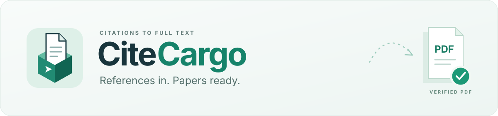
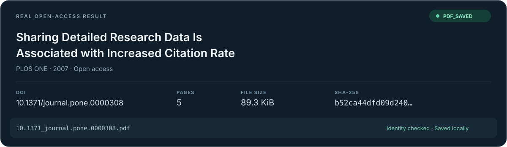

<div align="center">



### Less hunting. More reading.

**Paste references. Collect full texts. File them in Zotero when you need to.**

[Download the local app](https://github.com/Xplore-LAB/paper-tool/releases/download/v1.2.0/CiteCargo-1.2.0-Windows.zip) · [Download the AI skill](https://github.com/Xplore-LAB/paper-tool/releases/download/v1.2.0/CiteCargo-1.2.0-Skill.zip) · [Chinese](../README.md) · [Feedback](https://github.com/Xplore-LAB/paper-tool/issues)

</div>

> This branch contains the **V2 release candidate**: an offline skill and bounded task protocol. Download links above still point to stable 1.2.0. Cross-platform runtime acceptance for V2 is pending.

Give CiteCargo a DOI, a full citation or a reference list. It finds accessible full texts, verifies the PDFs and tracks progress. **Save the files locally, or choose Zotero when you want to grow your library.**

## Choose your way in

| Interface | What you do | Best for |
|---|---|---|
| **AI skill** | Install it, then tell your assistant which papers you need | Researchers using an assistant with local command execution |
| **Local browser app** | Open the launcher, paste a list and click Download | Researchers who prefer a visual interface |

Both use the same retrieval engine. Neither connects to Zotero unless you choose archival.

## Get started

**With an AI assistant:** unpack the skill ZIP and place its `citecargo` folder in your assistant's supported skill directory. For Codex, use `~/.codex/skills/` and start a new session. Then ask:

> Use CiteCargo to download these papers. Save the main articles to my project folder.

The assistant handles installation and commands. Python 3.10+ and local execution capability are required; importing the skill into a chat-only client is insufficient.

**On Windows:** unpack the full app ZIP, then double-click `Start-CiteCargo.cmd`. Switch the page to English, paste one DOI or full citation per line, and start downloading. Retrieve individual PDFs, download a ZIP or open the save folder.

Python 3.10+ is a one-time prerequisite. The ZIP includes the basic Python dependencies. Keep the launcher window open while working; this is a local browser interface.

**On macOS or Linux:** install the Python package from [Releases](https://github.com/Xplore-LAB/paper-tool/releases/latest), then open the interface:

```bash
python -m pip install ./paper_tool-1.2.0-py3-none-any.whl
citecargo ui --lang en
```

PDFs are saved to `Downloads/CiteCargo/PDF` in your user folder by default. Task history lasts for the current session. After a restart, paste the list again to reuse verified local PDFs.

## Less searching, downloading and filing

- **Start with references:** resolve citations to DOIs and search open-access sources.
- **Verify before filing:** check PDF readability and paper identity; flag uncertain results for review.
- **Continue unfinished work:** retain verified PDFs and retry missing entries.
- **Choose files or a library:** download independently, or deduplicate by DOI and attach PDFs to an existing Zotero collection.
- **Use your institutional access:** an optional authorized ScienceDirect browser route works with existing campus, VPN or proxy access.

Institutional retrieval needs your own entitlement and additional browser components. Automatic fallback currently covers ScienceDirect papers with a Crossref PII. Zotero archival needs Zotero 10+, its local API and write authorization.

## A real delivery



Result card from a completed real download report. Example: [10.1371/journal.pone.0000308](https://doi.org/10.1371/journal.pone.0000308).

[Contributing](../.github/CONTRIBUTING.md) · [Changelog](changelog.md) · [MIT license](../LICENSE)

Local tests and browser interactions are verified. See the [release notes](https://github.com/Xplore-LAB/paper-tool/releases/latest) for Windows launcher, cross-platform automation and live Zotero acceptance status.
