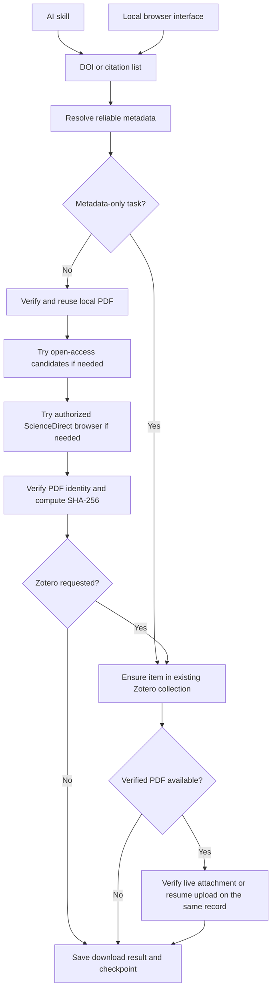

# Architecture and validation

Researchers enter through the AI skill or local browser interface. Both use the
`citecargo` CLI/engine, with `paper-tool` compatibility; implementation modules are
internal. See usage.md for the command/exit-code contract and operational steps.

V2 adds an offline wheel-only Skill and a versioned `plan -> job -> status`
protocol. Plans bind the original input digest, destination, permission scope
and policy. The job first runs a pilot, then bounded chunks, under one task guard.
Metadata preflight is explicit; its source pauses and budget carry into execution.
The existing UI still calls the batch engine and was not redesigned for V2.

- `src/paper_tool/cli.py`: CLI, single-paper flow, progress/audit/failure commands.
- `src/paper_tool/ui.py` and `web/`: foreground loopback server and bilingual UI.
- `skills/citecargo/`: AI instructions, using the same CLI rather than a separate downloader.
- `src/paper_tool/core.py`: metadata services, verification, downloads, Zotero protocol.
- `src/paper_tool/batch.py`: per-paper recovery and atomic checkpoint updates.
- `src/paper_tool/browser/download.mjs`: optional CDP/Playwright institutional route.
- `src/paper_tool/reports.py`: optional local spreadsheet and completion-report export.
- `src/paper_tool/agent.py`: plan validation, bounded execution and unified status.
- `src/paper_tool/safety.py`: source scheduling, budgets, cancellation and writer locks.
- `src/paper_tool/errors.py`: stable errors and string-compatible PDF diagnostics.

Download and archive state are separate. A checksum match permits a download
skip; an archival run rechecks the current collection and attachment state.
Legacy checkpoints without checksums require PDF identity verification again.
A remote `file://` URL belongs to the Zotero computer. It is not evidence of a
missing file on this computer. Safe recovery uses the original attachment key
and MD5 preconditions; unverifiable attachments are retained for review.

Tests cover parser/metadata matching, PDF identity, recovery, collection changes,
mocked Zotero requests, a loopback HTTP upload interruption, real Node file
publication with fake Playwright, and release archive hygiene. They do not prove
current institutional entitlement or compatibility with a live desktop Zotero.
Optional institutional/Zotero integrations require an acceptance run in the
user's own environment; their release status is documented separately.

The browser UI accepts one active batch per process. Host/origin checks and a
per-process token protect mutations. Downloads serve only verified PDF paths
inside the configured folder. Retry keeps the original checkpoint and only runs
unfinished references. Current-session history is in memory; PDFs and engine
checkpoints remain on disk after shutdown, and re-entering a list reuses verified
files. The UI server is a user-launched foreground process, not an installed daemon.

Remote Python requests include manual redirect scheduling. Loopback Zotero traffic
has separate treatment and write permission checks. The unchanged browser backend
is controlled at its Python operation boundary; browser page subrequests are not
individually metered. Per-task limits are not a machine-wide egress governor.

Skill builds validate wheel RECORDs, reviewed dependency hashes and dependency
closure across the required platform/Python matrix. An actual offline bootstrap,
version and plan/status test produces a payload-bound receipt for its host only.
`--require-matrix` rejects a formal bundle until all six runtime receipts match.
The manifest separates wheel compatibility from tested runtime coverage.
