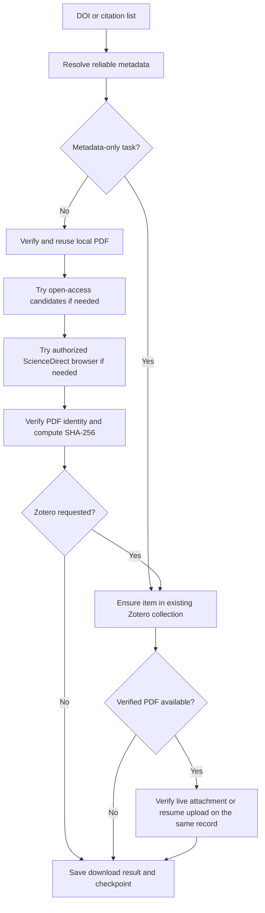

# Architecture and validation

The public interface is the `citecargo` CLI, with `paper-tool` compatibility; the implementation modules are
internal and may change. See usage.md for the command/exit-code contract and operational steps.

- `src/paper_tool/cli.py`: CLI, single-paper flow, progress/audit/failure commands.
- `src/paper_tool/core.py`: metadata services, verification, downloads, Zotero protocol.
- `src/paper_tool/batch.py`: per-paper recovery and atomic checkpoint updates.
- `src/paper_tool/browser/download.mjs`: optional CDP/Playwright institutional route.
- `src/paper_tool/reports.py`: optional local spreadsheet and completion-report export.

Download and archive state are separate. A checksum match permits a download
skip; an archival run rechecks the current collection and attachment state.
Legacy checkpoints without checksums require PDF identity verification again.
A remote `file://` URL belongs to the Zotero computer. It is not evidence of a
missing file on this computer. Safe recovery uses the original attachment key
and MD5 preconditions; unverifiable attachments are retained for review.

Tests cover parser/metadata matching, PDF identity, recovery, collection changes,
mocked Zotero requests, a loopback HTTP upload interruption, real Node file
publication with fake Playwright, and release archive hygiene. They do not prove
current institutional entitlement or compatibility with a live desktop Zotero.
Optional institutional/Zotero integrations require an acceptance run in the
user's own environment; their release status is documented separately.
